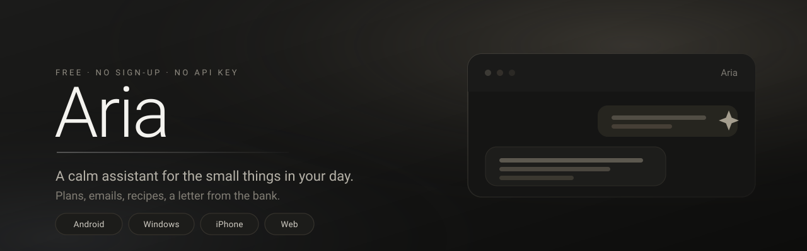

<p align="center">
  <a href="https://alleluia-hash.github.io/aria-chat/">
    
  </a>
</p>

[**Open Aria in your browser**](https://alleluia-hash.github.io/aria-chat/) &nbsp;·&nbsp; [Android (.apk)](https://github.com/alleluia-hash/aria-chat/releases/latest) &nbsp;·&nbsp; [Windows (.zip)](https://github.com/alleluia-hash/aria-chat/releases/latest) &nbsp;·&nbsp; [itch.io](https://doggieeee.itch.io/aria-ai)

A small, free AI assistant that gets tasks done. One page, no build step, no API keys of your own, no backend, no tracking. Hand it the task and the files, and it hands back the finished thing.

  

## What it is

Aria is a normal chat window with one change of emphasis: you give her a task rather than a question. A file to read, a plan to build, a script to fix, a form to fill, a week to organise — she works out what finished looks like, does it, and gives you the thing itself instead of advice about it. It is deliberately plain: a text field, a paperclip, a timeline of replies, and nothing to configure.

It answers with Markdown: lists, **bold**, tables, and code blocks with a copy button. Your conversation stays in your browser and is there when you come back.

When a question needs a fact or a number, she searches the web first — real search results, Wikipedia in your language, live weather, exchange rates and crypto prices — and puts the sources under the reply.

## Using it

Open `index.html` in a browser, or serve the folder:

```bash
python3 -m http.server 3000
```

Then visit <http://localhost:3000>.

There is nothing to install, no account, no key.

### The Android and Windows apps

The same page is also packaged as an Android APK and a Windows zip. GitHub
Actions builds both on every push that touches the page and publishes them as
a release named after `package/VERSION`:

1. change something, then bump `package/VERSION` (`1.2.0` -> `1.2.1`)
2. bump the `?v=` on the `styles.css` and `app.js` links in `index.html` to the same number, so a browser (or a phone) fetches the new files instead of a cached copy
3. push to `main`

The workflow then builds the APK (versionName `1.1.1`, versionCode `10101`),
the Windows zip and the combined zip, and creates the release `v1.1.1`, which
becomes the latest download at
<https://github.com/alleluia-hash/aria-chat/releases/latest>.

An installed app carries its own copy of `index.html`, `app.js` and
`styles.css`, so it never changes by itself: it keeps running the code it was
installed with until a newer APK is installed.

### The itch.io page

itch.io has no "watch this repository" switch, so a page filled in by hand has
to be uploaded again by hand. The way around that is `butler`, itch.io's own
command-line uploader: the same workflow that publishes the GitHub release
pushes the finished build to the page right after it, so a new version reaches
itch.io without anyone clicking anything.

The upload stays off until two things exist in this repository:

| Where to add it | Name | Value |
| --- | --- | --- |
| Settings -> Secrets and variables -> Actions -> **Secrets** | `BUTLER_API_KEY` | your itch.io API key, from <https://itch.io/user/settings/api-keys> |
| Settings -> Secrets and variables -> Actions -> **Variables** | `ITCH_PROJECT` | your page address without `https://` and `.itch.io`, e.g. `yourname/aria-chat` |

With both in place, every run pushes two channels, and both are downloads —
nothing on the page is played in the browser:

- `windows` - `Aria.exe` with the page files next to it
- `android` - `Aria.apk`

Each push is stamped with the version from `package/VERSION`, so the itch.io
page and the GitHub release always show the same number.

### Hosting it for other people (GitHub Pages)

1. In this repository: **Settings → Pages**
2. **Source:** Deploy from a branch
3. **Branch:** `main`, folder `/ (root)` → **Save**

A minute later the assistant is live at:

```
https://alleluia-hash.github.io/aria-chat/
```

## How the AI part works

Aria is the interface; the language model is served by someone else. That is what keeps it free and keyless.

| Lane | What it costs | Speed |
| --- | --- | --- |
| Default: public keyless model endpoint | Free, no account | Paced at roughly one answer a minute per network, shared by everyone |
| Optional: free Puter account | Free account, no card | Instant, streaming replies |

The default lane is a generous free service, so it paces requests. When you hit that pace, Aria says so, counts down, and answers on its own — nothing is lost and nothing breaks. If you'd like instant replies, the same card offers a free account sign-in; after that, replies stream word by word.

If a provider is unreachable, Aria keeps the conversation and offers a retry rather than failing silently.

## Live lookups

Before answering a factual question, the page itself fetches a public source straight from your browser and hands it to the model as evidence:

| You ask | She reads |
| --- | --- |
| Almost anything factual | A live DuckDuckGo web search, read through the public r.jina.ai reader — titles, snippets and links from real sites |
| Who, what, when, how many, how tall | Wikipedia, in your language and in English |
| Weather | Open-Meteo, the same open data most weather apps use |
| Currency | open.er-api.com exchange rates |
| Crypto prices | CoinGecko |

Each reply that used them ends with a small "Looked up:" line linking what she read, so you can check it yourself. The search is what makes specific answers possible: ask how many copies a book sold in Italy and the snippets carry the figure, where an encyclopaedia alone would not have it. When the exact number you asked for really is not published anywhere in the results — or the sites disagree — she says so, gives the figures she found clearly labelled, and does not invent one.

## Attaching files

The paperclip attaches anything at all — there is no list of allowed types. Dragging a file onto the box, or pasting one, does the same thing. Nothing is uploaded: the browser reads the file on your device and puts its contents into the message you send.

| You attach | What Aria gets |
| --- | --- |
| Text, notes, CSV, JSON, logs, code | The text itself |
| PDF | The text layer, pulled out of the page streams |
| Word, Excel, PowerPoint, OpenDocument | The text from the document parts inside the container |
| Zip and other archives | The list of files inside, so she can ask which one matters |
| Photos | Measured in this browser, pixel by pixel: shape, size, main colours, how much of the frame is detail, and whether it looks like text or a photo. With a free Puter account she also sees the picture itself |
| Audio, video | The name, type and size — describe them instead |

Up to 10 files, 25 MB each, and a very long file is clipped rather than failing. When a PDF is a scan with no text layer, or a file cannot be read at all, Aria says so instead of inventing what was in it.

## Files out

Ask for a document and she hands you the file itself, written in your browser — not a description of what the file could contain.

| You ask for | You get |
| --- | --- |
| A report, a letter, a plan, meeting notes | A Word document (`.docx`) with headings and lists |
| A budget, a tracker, a price list | An Excel workbook (`.xlsx`) with real formulas, so the totals recalculate when you edit a cell |
| A deck, a pitch, a lesson | A PowerPoint file (`.pptx`), split across slides rather than one endless one |
| Something to print or send | A PDF |
| Text you want to keep | Markdown or CSV |

Every answer also has **Save as** underneath it, which turns the answer you are reading into any of those files. A preview opens in the page first, so you can check the numbers and the wording before you download.

## Privacy

- No analytics, no cookies, no accounts required, no server of ours in the middle.
- Attached files are read in your browser; their text joins the message you choose to send, and nothing else about the file leaves your device.
- Conversations are stored only in this browser's `localStorage`.
- The text you type is sent to the model provider that answers. The words you look up go to DuckDuckGo and the r.jina.ai reader, then to Wikipedia, Open-Meteo, the exchange-rate API and CoinGecko; nothing else leaves the page. Like every hosted AI, treat it as a third party: don't paste passwords, card numbers or anything you wouldn't put in a search box.
- "New chat" clears the conversation from this browser.

## Files

```
index.html   the page
styles.css   the look: one column, light and dark, mobile-first
app.js       chat logic, Markdown rendering, storage, providers, live lookups, file reading, the Word/Excel/PowerPoint/PDF writers and the picture reader
```

No frameworks, no bundler, no dependencies to audit. The only external script is the optional Puter sign-in library.

## Changing the model

The default lane uses the keyless `openai-fast` endpoint. If you'd rather use your own free key (Groq, Gemini, OpenRouter all have free tiers), replace `KEYLESS_ENDPOINT` and the request body in `askKeyless()` in `app.js` — the rest of the app is provider-agnostic.

## Limits, honestly

- It is not GPT-5-class at long reasoning or maths. She reads the search results and the public sources listed above, so she can answer with real, current figures, but she reads snippets rather than full articles, and she cannot get past a paywall or a site that blocks readers.
- Pictures are measured, not read. She can tell you the shape, the colours, how busy the frame is and where the text sits, and she can say when something looks like a scan of a document — but she cannot read the words inside a picture, and she will not pretend to. Audio and video still arrive as a name, a type and a size.
- Search runs through a free public reader, which allows a handful of searches a minute; when it is busy she falls back to Wikipedia and says what she used.
- Compressed conversations can lose detail; start a new chat for a new topic.
- Free public endpoints can be slow or briefly unavailable. The app tells you instead of pretending.
- Replies can be wrong. Check anything that matters — medical, legal, money.

## License

MIT — see [LICENSE](LICENSE).
